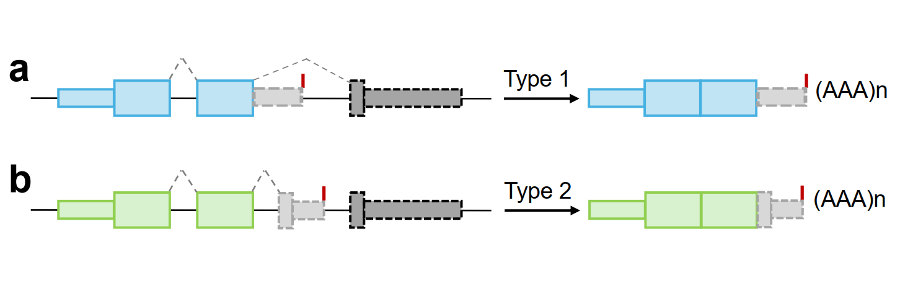
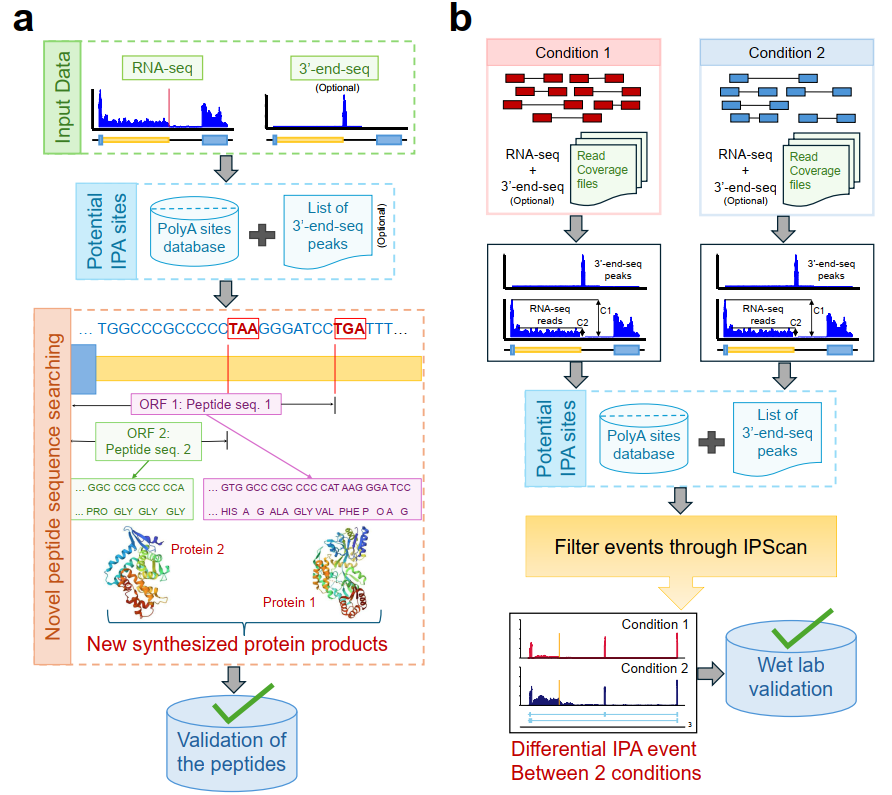
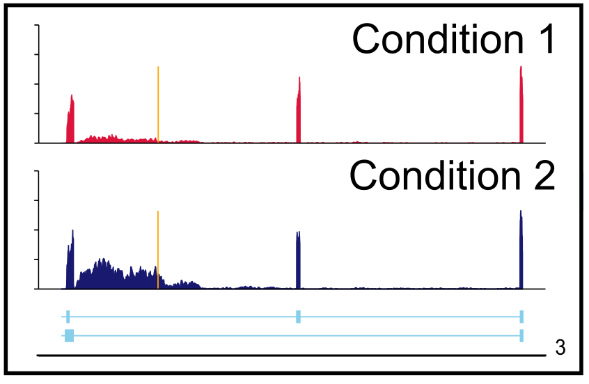

# IPScan

IPScan detects candidate intronic polyadenylation events from RNA-seq coverage data and reports coverage-based evidence.

## Project structure

```text
IPScan/
├── ipscan.py                 # Command-line entry point
├── methods/                  # Reusable analysis functions
│   ├── annotation.py         # Exon, intron, and interval utilities
│   ├── coverage.py           # Coverage-table operations
│   ├── methods.py            # Event detection workflow
│   └── print_and_log.py      # Logging helper
├── anno/                     # Pre-generated species annotations
├── config/                   # Configuration templates
├── test_data/                # Small example inputs
├── tests/                    # Automated tests
├── requirements.txt          # Runtime and test dependencies
└── pyproject.toml            # Standard Python project metadata
```

## Environment

Use Python 3.8 or newer:

```bash
python3 -m venv .venv
source .venv/bin/activate
python -m pip install -r requirements.txt
python -m pip install -e .
```

Run tests with:

```bash
python -m pytest
```

## Command-line usage

The current workflow accepts a group directory containing multiple BAM files, or multiple sample directories containing chromosome-level coverage tables. Each coverage sample directory should contain files named `chr1.txt`, `chr2.txt`, and so on. BAM files are converted to these tables automatically.

```bash
python ipscan.py \
    --mode single \
    --species hg38 \
    --input-dir1 /absolute/path/to/group1 \
    --annotation /absolute/path/to/annotation.tsv \
    --output-dir /absolute/path/to/output \
    --log-dir /absolute/path/to/logs
```

PolyA site input defaults to the pre-provided PolyA_DB annotation in `anno/`. To add peaks from 3'-end-seq BAM files, provide a directory containing those BAM files:

```bash
    --three-prime-dir /absolute/path/to/three_prime_bams
```

IPScan generates intronic 3'-end peaks, merges them with PolyA_DB, saves the combined annotation under `anno/`, and uses it for the run. Omitting `--three-prime-dir` uses PolyA_DB only.

For reproducible runs, parameters may be stored in TOML. See `config/config.example.toml` and run:

```bash
python ipscan.py --config config/config.example.toml
```

Explicit CLI arguments override values from the configuration file. Use `--peptides` or `--no-peptides` to override the peptide setting.

The example configuration is available at `config/config.example.ini`. The checked-in `config/config.ini` contains machine-specific legacy paths and should not be used as a portable default.

## Annotations

Pre-generated polyadenylation annotations are stored in `anno/`. Gene annotations used for exon and intron construction are supplied separately with `--annotation`.

## Current scope

Single mode processes every BAM or coverage sample found in `--input-dir1`. Differential mode requires both `--input-dir1` and `--input-dir2`, processes every sample in each group, and reserves comparison for a separate metric function that is not implemented yet.
## Introduction
IPScan is a robust computational pipeline that can detect the de-novo IPA sites from the RNAseq samples and measure the dynamic IPA sites' usage among different biological conditions. The major contribution of IPScan are: 

- To detect both Type-1 (composite) and Type-2 (skipped) IPA events.
- To Measure the differential IPA events among conditions
- To identify the potential novel peptide sequences to enrich protein domain annotation.

## IPScan workflow in two scenarios
IPScan detects two distinct types of IPA events. a) Type-1 (composite): Occurs when the first step of splicing is inhibited, leading to polyadenylation within the downstream intron. b) Type-2 (skipped): Involves the inclusion of a cryptic exon within the downstream intron, which becomes the new 3'-end exon.



a) IPScan detects novel IPA events and generates peptide sequences from the newly identified truncated isoforms. b) The detection and quantification of differential IPA events between two conditions, with coverage plots showing read coverage flanking the IPA sites in both conditions. 



## Installation
IPScan is developed using Python3. \
Install the following software pre-requisites: \
    1. python3 packages: itertools, pandas, numpy, collections, multiprocessing, scipy, argparse, os, warnings, and subprocess
    2. Clone the lastest development version of IPScan from the github repository: git clone https://github.com/compbiolabucf/IPScan.git

## Usage
IPScan pipeline contains 2 python scripts: \
    1. ipscan.py: can be used in 2 modes: 'single' or 'differential'. Single mode identifies the IPA sites from any given RNA-seq sample, whereas 'differential' mode identifies IPA sites in both conditions, along with measuring the dynamic usage of the detected sites. The unannotated peptide sequences will be generated if the 'Peptides' flag is on.  
    2. make_plots.py: generates the read coverage plots to illustrate the specific IPA event or differential IPA site usage on any given region. 

## Input
The input files for IPScan should be the absolute file paths. The list of arguments are:

| Argument  | Description   |
| ------- | -------- |
| --single or --differential   | whether to run on single or differential mode |
| -species   | species name. Options are: hg19, hg38, mm10 or mm39 |
| --input-dir1   | directory containing group 1 BAM files or coverage sample directories |
| --input-dir2   | directory containing group 2 BAM files or coverage sample directories; required for differential mode |
| --three-prime-dir | optional directory containing 3'-end-seq BAM files for peak generation |
| -output_dir   | output directory to write the results |
| --peptides   | whether to generate novel peptide sequences or not |
| -log   | absolutre directory of log files |

### Detect novel IPA sites from RNA-seq sample

    $python3 ipscan.py --single -species hg38 -s1 input_dir1 -anno annotation_file -out output_dir -log log_dir


IPScan will detect the novel intronic APA events on the given sample. The events are categorized into type-1 (composite) and type-2 (skipped) based on their structure of formation. The output csv file will have the following information:

| Column  | Description   |
| ------- | -------- |
| Chrom  | Chromosome Name   |
| Gene Name  | Gene Symbol   |
| Strand  | Strand information   |
| Intron Start  | Start position of the intron where the event occurs   |
| Intron End  | End position of the intron where the event occurs    |
| IPA position  | The location of the event   |
| Event type  | Type of the event: Type-1 or Type-2   |
| C1 | Read coverage upstream of the IPA site |
| C2 | Read coverage downstream of the IPA site |
| Truncation Ratio (TR) | Truncation ratio TR = C2/C1 which defines the event|

### Generating de-novo peptide sequences

    $python3 ipscan.py --single -species hg38 -s1 input_dir1 -anno annotation_file -out output_dir --peptides -log log_dir


The output file will have the following information:
| Column  | Description   |
| ------- | -------- |
| Chrom  | Chromosome Name   |
| Gene Name  | Gene Symbol   |
| Strand  | Strand   |
| Tx Name  | Transcript ID   |
| IPA Position  | Position of the IPA event   |
| Region Start  | Start position of the potential region   |
| Region End  | Start position of the potential region   |
| Event Type  | Type of the event: Type-1 or Type-2   |
| Nucleotide Sequence  | Nucleotide sequence of the region extracted from the genome   |
| Peptide Sequence  | De-novo peptide sequence   |

### Measure differential IPA events among conditions

    $python3 ipscan.py --differential -species hg38 -s1 input_dir1 -s2 input_dir2 -anno annotation_file -out output_dir -log log_dir


The output file will have the following information:

| Column  | Description   |
| ------- | -------- |
| Chrom  | Chromosome Name   |
| Gene Name  | Gene Symbol   |
| Strand  | Strand information   |
| Intron Start  | Start position of the intron where the event occurs   |
| Intron End  | End position of the intron where the event occurs    |
| IPA position  | The location of the event   |
| Event type  | Type of the event: Type-1 or Type-2   |
| C1_1 | Read coverage upstream of the IPA site for sample1 |
| C2_1 | Read coverage downstream of the IPA site for sample1 |
| C1_2 | Read coverage upstream of the IPA site for sample2 |
| C2_2 | Read coverage downstream of the IPA site for sample2 |
| TR1 | Truncation ratio TR1 = C2_1/C1_1 |
| TR2 | Truncation ratio TR2 = C2_2/C1_2 |
| abs(TR2 - TR1) | Absolute difference between TR1 and TR2 |

### Generate read coverage plots
make_plots.py will generate read coverage plots for both --single and --differential event. The program will ask input region from the user in its argument.

    $python3 make_plots.py --differential -species hg38 -s1 sample1.bam -s2 sample2.bam -anno annotation_file -out output_dir -log log_dir

    Please enter the region: [format: chrom: start - end: position]

The read coverage plot for differential IPA event will look like this:


# Contact the Author
Naima Ahmed Fahmi: naima.ahmed.fahmi@ucf.edu
Wei Zhang: wzhang.cs@ucf.edu


